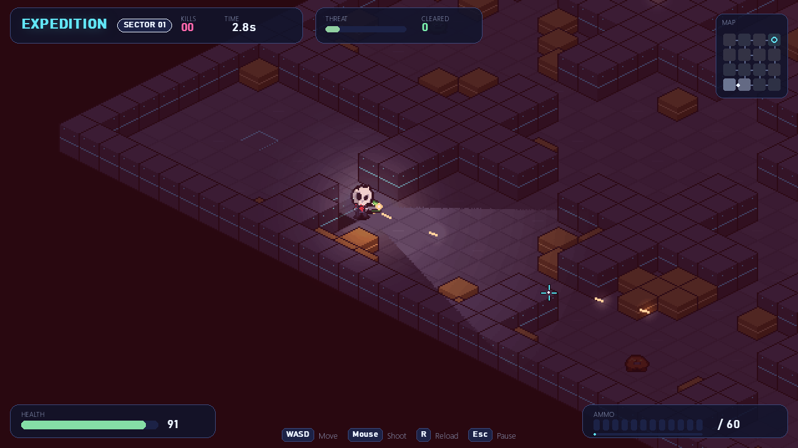

# Expedition

An isometric pixel-art alien shooter. Fight through sectors of alien-infested rooms, shoot down the nests, and reach the beacon. Every map is built by a constraint solver, and the aliens hunt you with real graph-search algorithms.



## Play (Windows)

1. Download `Expedition-v1.0.0-windows.zip` from the [Releases](../../releases) page.
2. Unzip it anywhere and double-click **Expedition.exe** (keep the folder together).
3. Windows may say *"Windows protected your PC"* because the game is not code-signed: click **More info → Run anyway**.

| Key | Action |
|---|---|
| W A S D | Move |
| Mouse | Aim; click or hold to shoot (Space also shoots) |
| R | Reload |
| Esc | Pause: resume, settings, quit to menu |
| F1 / F11 | Help / fullscreen |

- **Runs:** clear sectors in a row; each clear makes the next one harder. Dying ends the run. Your best run, most kills, fastest clear and total kills show on the title screen.
- **Ammo:** armories hold ammo and health, aliens sometimes drop ammo (Brutes usually do), and when you are completely out your sidearm takes over: unlimited, but slow.
- **Settings:** volume, sound, fullscreen, screen shake. Settings and records are saved in `%APPDATA%\Expedition`.

## How the AI works

| Part | Where | What it does |
|---|---|---|
| Constraint satisfaction | `expedition/rooms.py` | Each map is a 4×4 grid of rooms. Rooms are variables; (room type, doors) pairs are values. Doors must match between neighbours, nests are never adjacent, total difficulty stays within a budget, harder maps need more nests, and every room must connect to the start. Backtracking with Forward Checking and AC-3; A* then confirms the beacon is reachable. |
| Graph search | `expedition/search.py`, `expedition/world.py` | Globs follow one shared BFS distance map toward you, Skitters replan with Greedy best-first search, Brutes replan with A*. |
| Adaptive difficulty | `expedition/director.py` | A challenge level rises when you clear sectors and drops when you die; each sector is the candidate map closest to it. |

## Run from source

```bash
python -m venv .venv
.venv\Scripts\python -m pip install pygame-ce==2.5.8 pytest
.venv\Scripts\python run_game.py
```

Tests: `.venv\Scripts\python -m pytest` (logic, saves and hidden-window screen tests).

## Build the Windows app

```bash
.venv\Scripts\python -m pip install pyinstaller==6.22.3 pillow
powershell -ExecutionPolicy Bypass -File build\build.ps1
```

This builds `dist\Expedition\Expedition.exe`, runs it through a scripted self-check (`--smoke`), and zips it as `dist\Expedition-v1.0.0-windows.zip`.

## Origin

Expedition started as a mode of the NEUROFORGE AI course project and was split out as a standalone game. The hero is a pixel version of the author's skull logo; all other art and every sound are generated in code.
